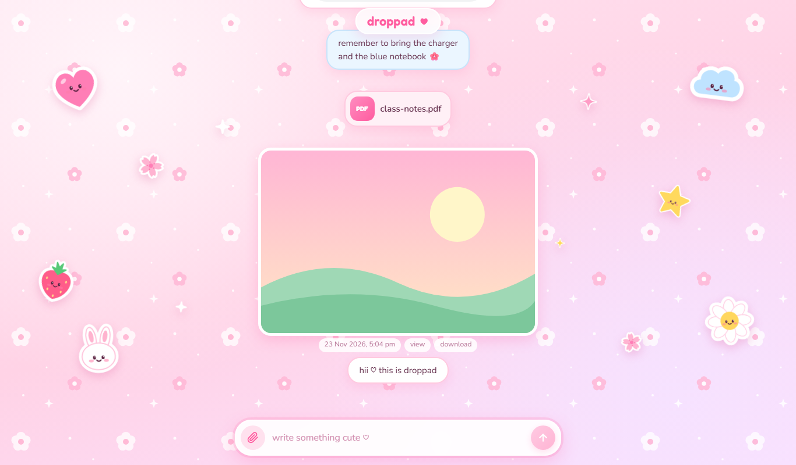
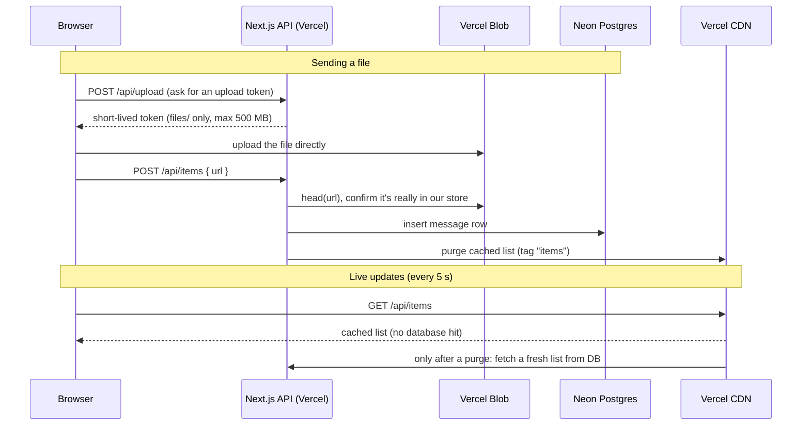

# droppad ♡

A tiny, cute place to drop text and files and pick them up from any device.

No accounts, no names, no setup. Open the page, type a message or attach a file, and it's there on your phone, laptop or a friend's computer a few seconds later.

**Live:** https://droppad.vercel.app



---

## Features

- **One message box.** Type text, attach files, or both, then press Enter or the send button.
- **Any file type**, up to 500 MB per file: images, PDFs, zips, docs, videos, audio, anything.
- **Previews in the chat.** Images show inline, videos and audio play right on the page, and other files appear as a card with their type (PDF, ZIP, DOCX...).
- **View and download.** Open any file in the browser or download it with its original name.
- **Copy text** with one click, or download a message as a `.txt` file.
- **Drag & drop or paste.** Drop files anywhere on the page, or paste a screenshot straight into the box.
- **Live updates.** Every open page checks for new messages every 5 seconds, no refresh needed.
- **Nothing extra on screen.** Only the content is shown; the date and time appear when you hover (or tap on phones).
- **Saved permanently.** Messages and files stay until someone removes them.
- **Cute by design.** Pink flower background, die-cut stickers (heart, strawberry, bunny, cloud, daisy, star, sakura), soft pastel bubbles, and it works on phones too.

## How to use

| To do this | Do this |
| --- | --- |
| Send a message | Type in the box at the bottom and press **Enter** |
| New line in a message | **Shift + Enter** |
| Send a file | Click the 📎 button, drag files onto the page, or paste them |
| Remove an attached file before sending | Click the **×** on its chip |
| See when something was sent | Hover over it (tap on phones) |
| Open / save a file | Hover, then **view** or **download** |
| Copy a message | Hover, then **copy** |

> ⚠️ droppad is **public**: anyone with the link can see and add messages. Don't drop passwords or private documents.

---

## How it works



- **Files** go from the browser **straight to Vercel Blob** (client uploads), so they skip Vercel's 4.5 MB request limit. Files over 100 MB are uploaded in parts.
- **Messages** (text, plus a pointer to each file) live in a **Neon Postgres** table.
- **The list is cached on Vercel's CDN** under the tag `items`. Each new message purges that tag, so every open page sees it on its next check. In between, the 5-second checks are served from the cache and never touch the database or the storage quota.
- **Safety checks:** upload tokens only allow paths under `files/`, and the server verifies every file URL with `head()` before saving it, so nobody can slip in links to outside content.

## Tech stack

| Part | Used |
| --- | --- |
| Framework | [Next.js 16](https://nextjs.org) (App Router) + React 19 |
| File storage | [Vercel Blob](https://vercel.com/docs/vercel-blob) (public store) |
| Database | [Neon](https://neon.tech) serverless Postgres (via the Vercel Marketplace) |
| Caching | Vercel CDN + cache tags (`@vercel/functions`) |
| Hosting | [Vercel](https://vercel.com), auto-deployed from `main` |
| Fonts | Fredoka + Nunito (Google Fonts via `next/font`) |
| Styling | Plain CSS; stickers and flower pattern are hand-made inline SVG |

## Project structure

```
droppad/
├── app/
│   ├── page.js              # the whole UI: message box, feed, live polling, uploads
│   ├── stickers.js          # SVG stickers (heart, strawberry, bunny, cloud, daisy, star, sakura)
│   ├── globals.css          # pink theme, flower background, bubbles, message box
│   ├── layout.js            # fonts, page title, theme colour
│   ├── icon.svg             # favicon (pink heart)
│   └── api/
│       ├── items/route.js   # GET list of messages · POST a new text or file
│       └── upload/route.js  # issues upload tokens for direct-to-Blob uploads
├── docs/screenshot.png
└── package.json
```

## API

### `GET /api/items`

Returns every message, newest first. Cached on the CDN until a new message is saved.

```json
[
  { "id": "1795588833672-ewr5mr", "kind": "text", "text": "hii ♡", "name": null, "url": null, "downloadUrl": null, "time": "2026-11-25T06:40:33.676Z" },
  { "id": "1795588832264-2h2qsi", "kind": "file", "text": null, "name": "notes.pdf", "url": "https://….public.blob.vercel-storage.com/files/…/notes.pdf", "downloadUrl": "…?download=1", "time": "2026-11-25T06:40:32.291Z" }
]
```

### `POST /api/items`

Save a text message:

```json
{ "text": "hello!" }
```

Or register a file that was just uploaded to Blob:

```json
{ "url": "https://<store>.public.blob.vercel-storage.com/files/<id>/<name>" }
```

Text is limited to 50,000 characters. Returns `{ "ok": true }`, or `400` with an `error` message.

### `POST /api/upload`

Used by `upload()` from `@vercel/blob/client`; you never call it by hand. It hands the browser a short-lived token that only allows uploading to `files/…`, with files up to 500 MB.

## Database

One table:

```sql
create table if not exists items (
  id           text primary key,
  kind         text not null check (kind in ('text', 'file')),
  text         text,
  name         text,
  url          text,
  download_url text,
  time         timestamptz not null default now()
);

create index if not exists items_time_idx on items (time desc);
```

---

## Run it locally

You need Node.js 20.9+ and the [Vercel CLI](https://vercel.com/docs/cli) (`npm i -g vercel`).

```bash
git clone https://github.com/imthegoodboy/droppad.git
cd droppad
npm install

# connect to the Vercel project and pull its secrets into .env.local
vercel link
vercel env pull .env.local

npm run dev
```

Then open http://localhost:3000.

Environment variables used:

| Variable | What it is |
| --- | --- |
| `BLOB_READ_WRITE_TOKEN` | Vercel Blob store token (added when the Blob store is connected) |
| `DATABASE_URL` | Neon Postgres connection string (added by the Neon integration) |

> Locally, the CDN cache and cache-tag purges are skipped, so every request reads straight from the database.

## Deploy your own copy

1. Fork this repo and import it into [Vercel](https://vercel.com/new).
2. Create a **public** Blob store and connect it to the project:
   ```bash
   vercel blob create-store droppad-files --access public --yes
   ```
3. Add a free Neon database from the Vercel Marketplace:
   ```bash
   vercel integration add neon
   ```
4. Create the table: run the SQL from [Database](#database) in the Neon SQL editor (or with `psql "$DATABASE_URL"`).
5. Redeploy. Every push to `main` deploys automatically after that.

## Free plan limits

droppad is built to stay inside Vercel's and Neon's free tiers for personal use:

| Thing | Free allowance | What uses it in droppad |
| --- | --- | --- |
| Blob storage | 1 GB | the files you upload |
| Blob uploads ("advanced operations") | 2,000 / month | 1 per file (files over 100 MB use a few) |
| Blob data transfer | 10 GB / month | viewing and downloading files |
| Neon storage | 0.5 GB | text messages (tiny) |
| Neon compute | 100 CU-hours / month | only when a message is saved or the cache is refreshed |

Text messages don't count against the Blob limits, and the live 5-second checks are served from the CDN cache, so leaving the page open is free. If the Blob limits are exceeded on the Hobby plan, Vercel pauses Blob until the next month, so keep an eye on **Usage** in the Vercel dashboard if you upload a lot.

## Removing things

There's no delete button on purpose: the page stays simple, and strangers with the link can't wipe it. To remove something:

- **A message:** delete its row in the Neon SQL editor, e.g. `delete from items where text = '…';`
- **A file:** delete the row as above, then the file itself in **Vercel → Storage → droppad-files**.

New rows show up for everyone within a few seconds. A deleted row can stay visible until the next new message clears the cache; to clear it right away, run `vercel cache dangerously-delete --tag items`.

---

made with ♡ and a lot of pink
